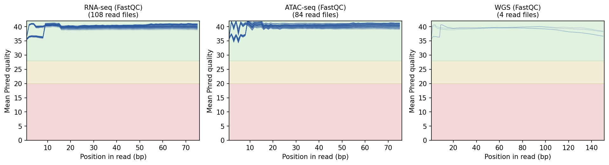
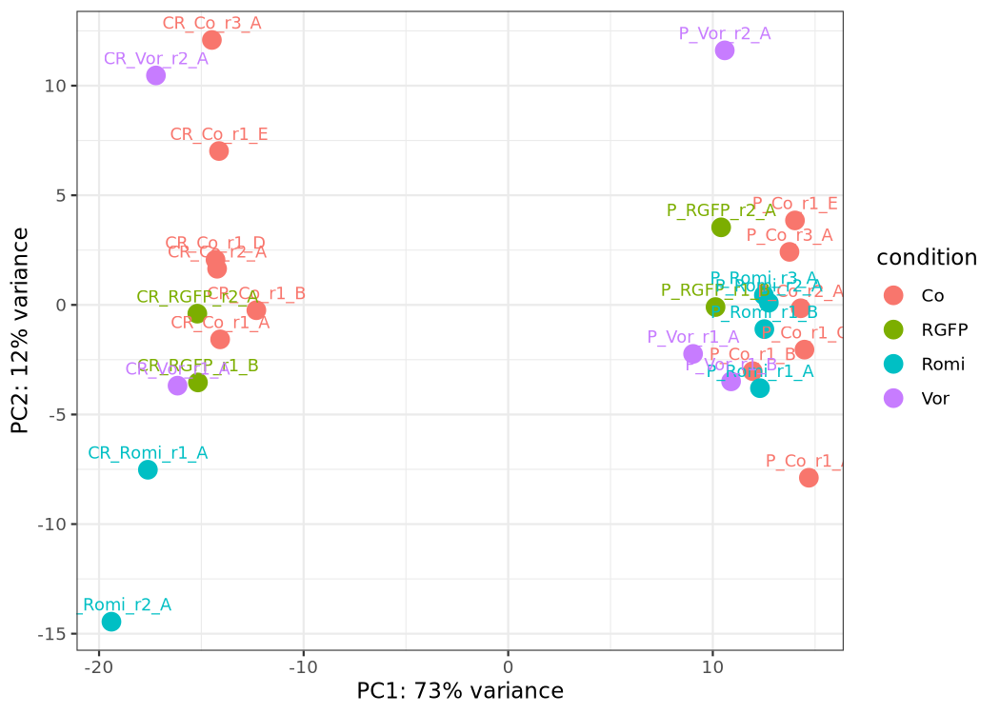
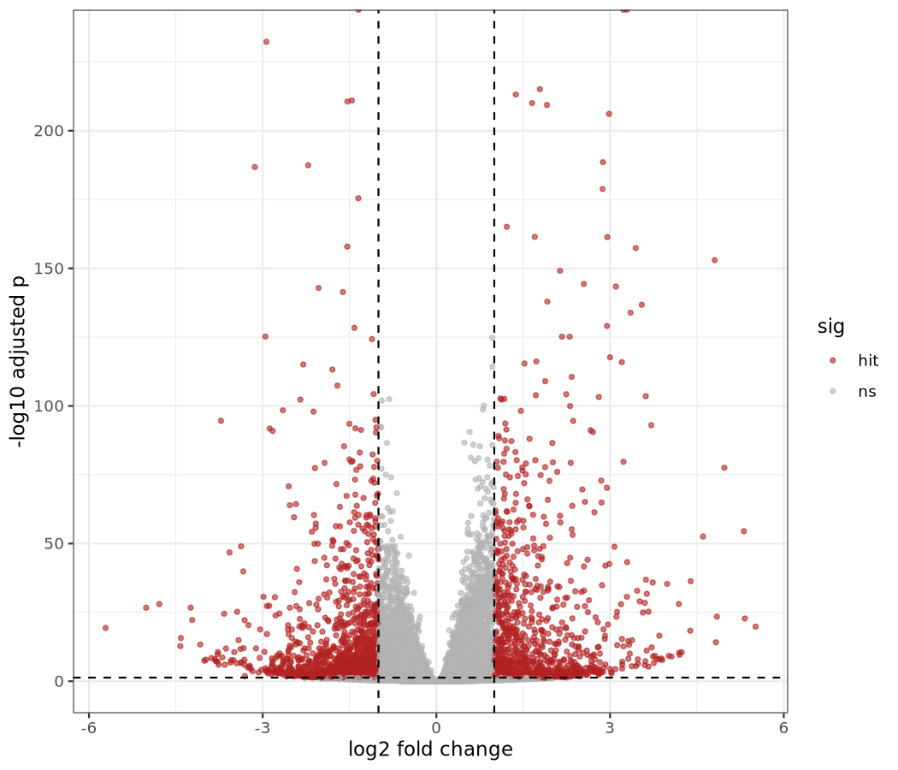
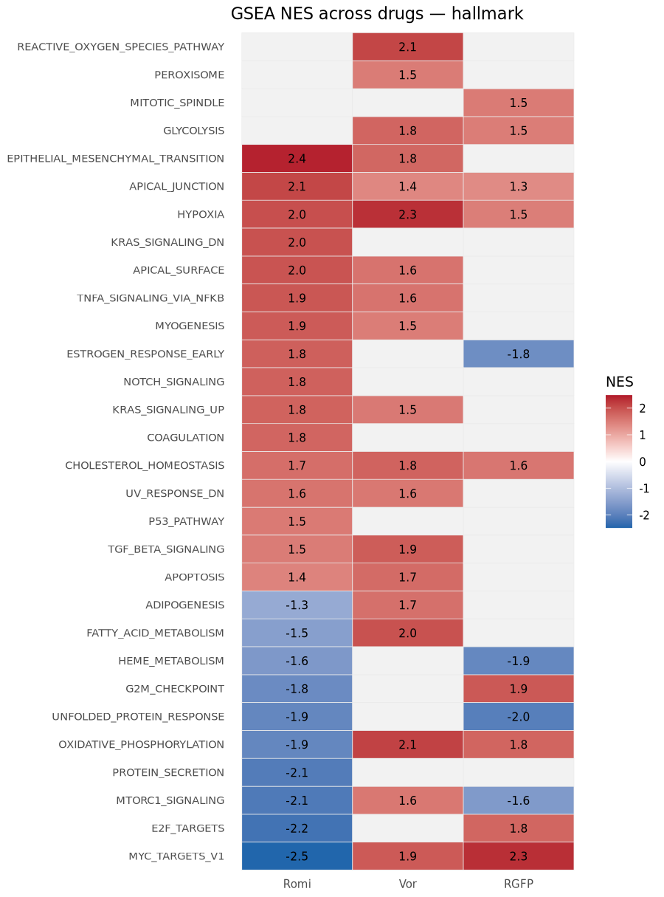
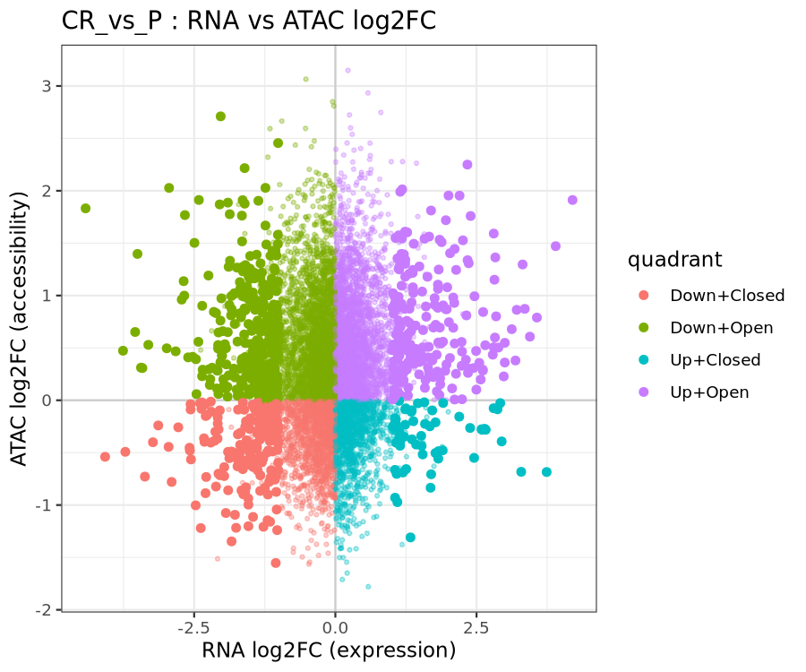

# Multi-omics of cisplatin-resistant small cell lung cancer

Is cisplatin resistance in small cell lung cancer (SCLC) written in the genome or in the chromatin? Can HDAC inhibitors reverse it? We profiled the **H1694** SCLC line, parental (**P**) and a stable cisplatin-resistant derivative (**CR**), with three sequencing assays and integrated them:

- **WGS** to test for an acquired genetic driver
- **RNA-seq** to measure the transcriptional programme of resistance and of three HDAC inhibitors
- **ATAC-seq** to measure chromatin accessibility, with a *Drosophila* spike-in for global changes

**Result:** resistance is epigenetic. There is no acquired loss-of-function in 14 SCLC driver genes. Resistance carries a 2,544-gene expression programme, and chromatin accessibility tracks it (Wilcoxon p = 1 × 10⁻⁷), with globally more compact chromatin in CR. The three HDAC inhibitors act through distinct programmes: romidepsin and RGFP966 push the MYC/E2F/G2M cell-cycle axis in **opposite** directions.

Laboratory report for the PAGI2LB course, MSc Bioinformatics, IMC Krems, July 2026, by F. Cazorla, J. Jerónimo and M. Solano (Group 7). Libraries were prepared by seven student groups and sequenced as one pool. This repository summarises the pooled analysis. The [`atac/`](atac/) folder holds my own ATAC-seq processing and QC in full.

## Study design

2 cell states (P, CR) × 4 arms, with the control arm most heavily replicated:

| Arm | Drug | Selectivity | RNA-seq libraries |
|---|---|---|---|
| Co | vehicle | | 12 |
| Romi | romidepsin (FK228) | class I, HDAC1/2 | 6 |
| Vor | vorinostat (SAHA) | pan-HDAC | 5 |
| RGFP | RGFP966 | HDAC3-selective | 4 |

| Assay | Libraries | Kit | Depth |
|---|---|---|---|
| RNA-seq | 27 | NEBNext UltraExpress RNA + poly(A) module | 3.6–36.9 M reads, 75 bp |
| ATAC-seq | 21 | Active Motif ATAC-Seq Express + *Drosophila* spike-in | 0.08–1.2 M reads, 75 bp |
| WGS | 2 (P, CR) | NEBNext UltraExpress FS DNA | 962 M (46×) / 504 M (24×), 150 bp |

Sequencing ran paired-end on an Element Biosciences AVITI.

## Analysis

All layers use GRCh38 with Ensembl gene models, so genes, peaks and variants share one annotation key.

| Layer | Pipeline | Key settings |
|---|---|---|
| QC | FastQC, fastp, STAR/Qualimap, Picard/samtools → MultiQC | |
| RNA-seq | STAR → featureCounts → DESeq2 | design `~ resistance + condition`; DE = padj < 0.05 and \|log2FC\| ≥ 1 |
| Enrichment | clusterProfiler | GSEA ranked by the DESeq2 Wald statistic; ORA; MSigDB Hallmark + GO-BP |
| ATAC-seq | Bowtie2 → MACS3 → featureCounts → DESeq2 | dm6 spike-in for the global metric, median-of-ratios for per-peak tests; edgeR cross-check |
| WGS | BWA → GATK HaplotypeCaller → bcftools → SnpEff | germline P vs CR, QUAL ≥ 30 and DP ≥ 10, GRCh38.99 |
| Integration | peak → gene via TxDb, joined on Ensembl ID | LFC correlation, sign test, Wilcoxon; WGS as a genetic-confound filter |

Modelling resistance as a covariate absorbs the dominant P/CR axis, so each drug can be tested against its own control.

## Results

### Quality control

| Metric (range across libraries) | RNA-seq | ATAC-seq | WGS |
|---|---|---|---|
| Bases ≥ Q30 | 90.7–92.8% | 90.7–93.9% | |
| Duplication | 2.5–7.9% | 0.3–6.2% | 43–44% |
| Adapter content | 0.8–7.8% | 11.4–60.9% | 1.0–1.4% |
| Uniquely mapped (STAR) / mapped (samtools) | 83.3–92.7% | | 98.8–99.5% |



Base quality is high for every assay. ATAC-seq is the weak layer. Its reads are shallow and adapter-rich, and its GC distribution is bimodal (30% and 48%), consistent with over-tagmentation. Only a minority of ATAC libraries showed a clean nucleosomal ladder. In our own group (Group 7), RNA inputs were intact (RINe ≈ 10), but library yields were uneven (RNA 0.03–2.5 ng/µL, ATAC 0.04–141 ng/µL), and our gDNA library failed QC. All results below therefore come from the class pool.

### WGS: no genetic driver of resistance

| CR-private variants | Count |
|---|---|
| genome-wide | 448,562 |
| in 14 SCLC driver genes | 187 |
| … high confidence (QUAL ≥ 30, DP ≥ 10) | 91 |
| … coding (SnpEff) | 1 |
| … loss-of-function | **0** |

The large genome-wide number is an artefact of comparing a 46× call set with a 24× one, not a burst of mutation. The single coding candidate is a conservative in-frame deletion in ***KMT2D*** (chr12:49,022,072, MODERATE). It is interesting because KMT2D is a histone methyltransferase, but it is weak evidence for a driver and leaves no RNA or ATAC footprint (see below).

### RNA-seq: resistance dominates



PC1 explains **73%** of the variance and splits P from CR. Drugs mix within each half. CR vs P gives **2,544 DE genes**, an order of magnitude more than any drug.



One library (CR_Romi_r2_A) was a mild outlier. Dropping it cut the Romi hits from 236 to 113, but the fold changes correlated at 0.95 with no sign flips, so it was kept.

### RNA-seq: three distinct drug programmes

| Contrast | DE genes | up | down |
|---|---|---|---|
| Romi vs Co | 236 | 192 | 44 |
| Vor vs Co | 51 | 13 | 38 |
| RGFP vs Co | 13 | 1 | 12 |



- **Romidepsin (HDAC1/2)** gives the full HDAC-inhibitor phenotype. Proliferation and biosynthesis shut down (MYC targets NES −2.48, E2F −2.24, G2M −1.83; telomere maintenance down). EMT, TNFα, p53 and apoptosis programmes are de-repressed.
- **Vorinostat (pan)** is a metabolic bridge. Hypoxia, OXPHOS and MYC targets go up, and it shares romidepsin's apoptosis and TNFα de-repression, but it doesn't arrest proliferation.
- **RGFP966 (HDAC3)** is the opposite pole: a coherent MYC/E2F/G2M biosynthesis programme goes **up**.

The cell-cycle sign flip between romidepsin and RGFP966 is strongly significant (MYC padj 5 × 10⁻⁹) and internally coherent. Under-dosing would give a weaker signal in the same direction, not the opposite one, so the flip reflects mechanism rather than power. Pairwise fold-change correlations between drugs are only 0.32–0.40, so the three arms were analysed separately.

### ATAC-seq: global compaction, little per-peak power

The spike-in fraction is about twice as high in CR (mean 0.108 vs 0.053), so **CR chromatin is globally less accessible**. Per-peak testing is underpowered: 0 significant peaks with DESeq2, 3 with edgeR, and none in any drug contrast. Details, QC and the spike-in table are in [`atac/`](atac/README.md).

### Multi-omic integration



- **Resistance axis.** Among 765 resistance DE genes with a tested peak, genes up in CR are significantly more open in CR than genes down in CR (Wilcoxon p = 1.06 × 10⁻⁷). Per-locus coupling is weak (Pearson 0.063, 52% sign agreement), so the bias is real in aggregate while single peaks are noisy. Standard normalisation removes the global compaction, so this is gene-specific evidence on top of the spike-in shift.
- **Drug axis.** No concordance (correlation 0.02). ATAC can't confirm the drug programmes at this depth.
- **WGS overlay.** The *KMT2D* in-frame deletion is silent in RNA (log2FC −0.07, padj 0.26) and only mildly, non-significantly changed in ATAC (+0.60).

All three layers agree: the resistance state lives in the transcriptome and chromatin, not in the driver-gene sequence. Consistent with the SCLC-N assignment of H1694, the subtype master TFs (NEUROD1, ASCL1, POU2F3) showed no notable involvement.

## Limitations

- ATAC-seq is shallow (FRiP mostly < 0.2, control n = 2 per state), so chromatin evidence is aggregate, not per-locus.
- WGS is germline-only, with no somatic caller (e.g. Mutect2 with P as normal) and no copy-number analysis. Copy gains could mimic an epigenetic change.
- RNA-seq replication is unbalanced (12/6/5/4) and the factorial is incomplete. RGFP's coherent GSEA signal rests on n = 4.
- One cell line, so the results don't generalise beyond H1694.

**Next steps:** deeper or Omni-ATAC on the same pair, with TF footprinting; somatic and copy-number WGS; a functional assay testing whether romidepsin-type remodelling restores cisplatin sensitivity.

## Repository layout

```
README.md            this summary (pooled analysis)
figures/             QC, RNA-seq, GSEA and integration figures from the report
atac/                my ATAC-seq processing: README, pipeline.md, results/, plots/
```

Reads, alignments and count matrices come from an unpublished teaching experiment and stay on the course server.

## Key references

- Solta A. *et al.* Entinostat enhances the efficacy of chemotherapy in small cell lung cancer through S-phase arrest and decreased base excision repair. *Clin Cancer Res* 29:4644–4659 (2023).
- Love M.I., Huber W., Anders S. Moderated estimation of fold change and dispersion for RNA-seq data with DESeq2. *Genome Biol* 15:550 (2014).
- Wu T. *et al.* clusterProfiler 4.0. *The Innovation* 2:100141 (2021).
- Buenrostro J.D. *et al.* Transposition of native chromatin for fast and sensitive epigenomic profiling. *Nat Methods* 10:1213–1218 (2013).
