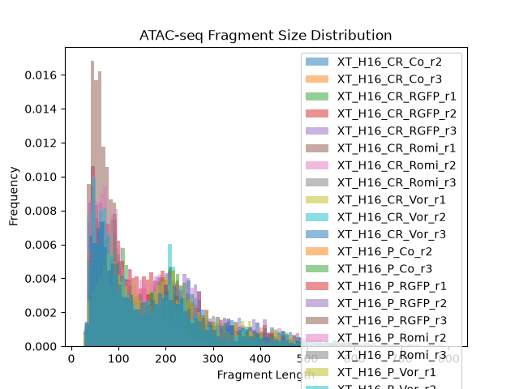
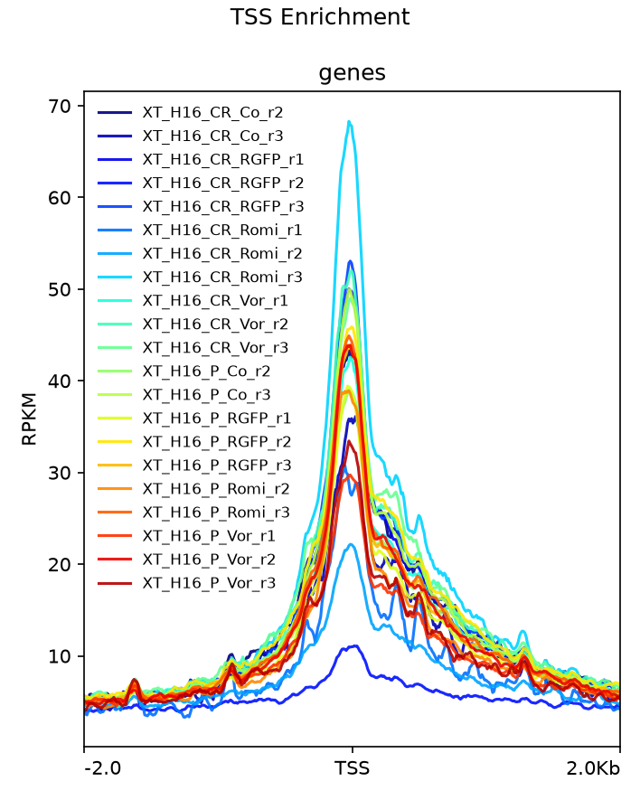
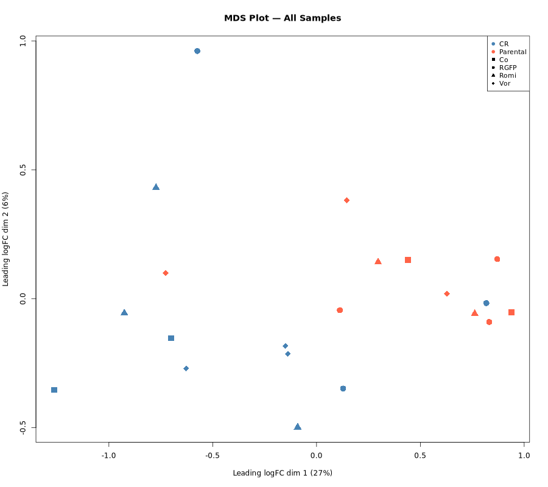
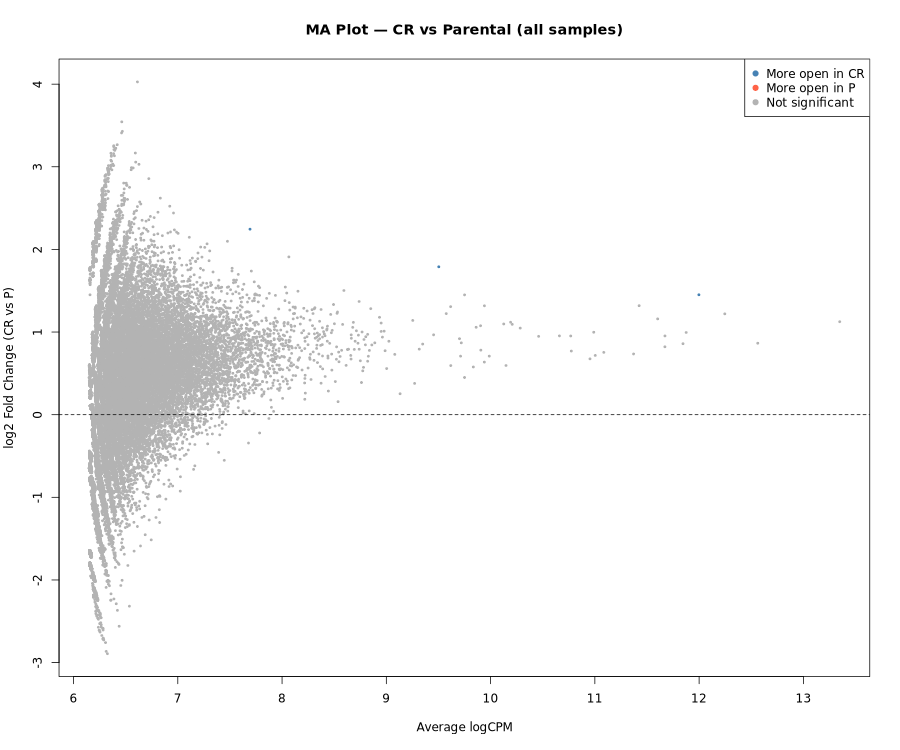

# ATAC-seq of CREBBP-mutant cells treated with HDAC inhibitors

Raw-data processing, quality control, *Drosophila* spike-in quantification and a first differential accessibility analysis of 21 shallow-sequenced ATAC-seq libraries. The cells are a CREBBP-mutant line (**CR**) and its parental line (**P**), each treated with three HDAC inhibitors or left untreated. The question for this QC run was: *which libraries are good enough to send for deep sequencing, and is the CR vs P difference already visible?*

All processing ran on a university HPC server as part of an MSc practical (Genomics & Transcriptomics, IMC Krems, 2026). This repository holds the methods, the per-sample QC summary, the spike-in fractions, the significant peaks and the figures. The reads, BAMs, peak files and count matrix are not included (see [Data](#data)).

## Background

**CREBBP** is a histone acetyltransferase. Loss-of-function mutations are common in follicular and diffuse large B-cell lymphoma and are expected to reduce histone acetylation and compact chromatin. **HDAC inhibitors** push the balance back towards acetylation, so they are a rational therapy for CREBBP-mutant tumours. Three were tested:

| Code | Drug | Class |
|---|---|---|
| Co | none (control) | |
| RGFP | RGFP966 | HDAC3-selective (class I) |
| Romi | Romidepsin | class I |
| Vor | Vorinostat | pan-HDAC |

Three biological replicates per condition were planned (24 libraries). Three are missing (CR_Co_r1, P_Co_r1, P_Romi_r1), so there are 21.

**Spike-in.** A fixed amount of *Drosophila melanogaster* chromatin was added to every sample before tagmentation. If a sample has less accessible human chromatin, fly reads make up a larger share of its library. Library-size normalisation hides this kind of global change; the spike-in fraction reveals it.

## Pipeline

```
FASTQ ──fastp──▶ trimmed ──Bowtie2 (GRCh38 + dm6)──▶ BAM ──samtools fixmate/markdup──▶ filtered BAM
                                                        │                                 │
                                                        └─ samtools idxstats ─▶ spike-in   ├─ deepTools: fragment sizes, TSS enrichment, bigWig
                                                                                            ├─ MACS3 (BAMPE) ─▶ peaks ─▶ FRiP, consensus peaks
                                                                                            └─ featureCounts ─▶ peak × sample counts ─▶ edgeR
```

| Step | Tool | Key settings |
|---|---|---|
| Reference | GENCODE GRCh38 primary (v50) + FlyBase dm6 (r6.68) | fly contigs prefixed `dm6_`; ENCODE blacklist ENCFF356LFX |
| Trimming | fastp 1.3.5 | `--detect_adapter_for_pe --length_required 20` |
| Alignment | Bowtie2 | `--no-mixed --no-discordant --maxins 2000` |
| Duplicates | samtools | name-sort → `fixmate -m` → coordinate sort → `markdup` |
| Filtering | samtools | `-f 2 -F 1804 -q 30`, human nuclear chromosomes only (no chrM, no `dm6_`) |
| Spike-in | samtools idxstats | fly reads / (human + fly reads), on the aligned BAM |
| Fragment sizes | deepTools 3.5.6 `bamPEFragmentSize` | max 800 bp |
| TSS enrichment | deepTools `computeMatrix reference-point` + `plotProfile` | ±2 kb, 10 bp bins, RPKM bigWigs |
| Peaks | MACS3 3.0.4 | `-f BAMPE --nomodel --nolambda --keep-dup all` |
| FRiP | bedtools intersect | reads in the sample's own peaks / filtered reads |
| Complexity | preseq `lc_extrap` | on duplicate-marked BAMs |
| Consensus peaks | bedtools merge | all 21 narrowPeak files → 97,042 regions |
| Counting | featureCounts 2.1.1 | `-F SAF -p --countReadPairs` |
| Differential accessibility | edgeR (quasi-likelihood F-test) | design `~ treatment + condition`; keep peaks with CPM > 1 in ≥ 3 samples (38,748); TMM |

[`docs/pipeline.md`](docs/pipeline.md) writes out each step as commands, rebuilt from the parameters recorded in the lab report.

## Results

### Library QC

Full table: [`results/qc_summary.tsv`](results/qc_summary.tsv).




- **All 21 libraries look like ATAC-seq.** The fragment sizes show a dominant nucleosome-free peak below 100 bp and a mono-nucleosome peak near 200 bp. Every sample has a clear peak at the TSS.
- **Depth is very shallow,** as intended for a QC run: 26k–519k reads per library after filtering.
- **Parental libraries map well; most CR libraries don't.** All P samples except P_Vor_r3 map at 98%. CR samples map at 22–98% (median 40%). The spike-in doesn't explain this: mapped reads equal human plus fly reads, so the lost reads simply don't align to either genome. Adapter dimers or contamination are the likely causes. The MultiQC report on the server would show which.
- **FRiP is low overall** (ENCODE recommends > 0.2). Only 7 libraries pass, all of them CR. FRiP is measured against each sample's own peaks, and some low-depth CR samples have high FRiP from few, strong peaks, so it shouldn't be compared directly between conditions.
- **CR_Co_r3** (25,686 reads) was too shallow for preseq to estimate complexity. **CR_Co_r2** has the flattest TSS profile.

### Spike-in

| | CR (n = 11) | P (n = 10) |
|---|---|---|
| Median fly fraction | 9.7% | 4.9% |
| Range | 2.0–43.1% | 1.2–12.7% |

CR libraries carry about **twice** as much fly chromatin as parental ones. This fits the expectation that CREBBP loss means less accessible chromatin, but the spread within each group is wide. CR_Romi_r2 (43%) is an outlier, and P_Vor_r3 (12.7%) is also the weakest parental library. Treat the difference as a hint, not a measurement, until the deep-sequencing data are in. Per-sample values: [`results/spikein_fractions.tsv`](results/spikein_fractions.tsv).

### CR vs parental



The first MDS dimension (27% of variance) separates most parental samples (right) from CR samples (left). Cell line is the main source of variation. Treatment doesn't group samples at this depth. CR samples are much more spread out than parental ones, matching their more variable QC.



Three of 38,748 peaks are significant at FDR < 0.05, all more open in CR ([`results/differential_peaks_FDR05.csv`](results/differential_peaks_FDR05.csv)):

| Peak | Location (hg38) | log2FC | FDR | Nearest gene |
|---|---|---|---|---|
| peak_2920 | chr1:39,958,213–39,961,492 | 1.79 | 0.008 | *MFSD2A* (1.2 kb) |
| peak_2896 | chr1:39,878,947–39,888,057 | 1.45 | 0.021 | *MYCL* / *MYCL-AS1* (overlapping) |
| peak_39650 | chr17:38,414,672–38,416,068 | 2.25 | 0.036 | *ARHGAP23* (3.2 kb) |

The MA cloud sits **above zero** (65% of peaks have log2FC > 0, median 0.34), so most peaks appear more open in CR after TMM normalisation. This conflicts with the spike-in, which points to *less* accessible chromatin in CR. TMM assumes most peaks don't change, and that assumption may not hold here. The variable mapping and depth of the CR libraries could also cause the shift. The next step is to repeat the test with spike-in-derived normalisation factors instead of TMM, and to see whether the skew and the three hits remain.

### Recommendation for deep sequencing

| Decision | Libraries |
|---|---|
| Sequence deeply | all parental except P_Vor_r3; CR_RGFP_r1, CR_Romi_r3, CR_Vor_r3 |
| Borderline (low depth or low FRiP) | CR_Co_r2, CR_Romi_r1, CR_Vor_r1, CR_Vor_r2, P_Vor_r3 |
| Repeat the library | CR_Co_r3 (too shallow), CR_RGFP_r2, CR_RGFP_r3, CR_Romi_r2 (FRiP < 0.08 despite reasonable depth; CR_Romi_r2 also 43% spike-in) |

## Limitations

- QC-depth data (< 0.6 M filtered reads per library). The differential analysis has very little power, and the three significant peaks are preliminary.
- No control condition has more than two replicates.
- Differential accessibility used TMM, not the spike-in. See the MA-plot discussion above.
- FRiP values come from per-sample peaks, not the consensus set.

## Data

The libraries come from an unpublished cell-line experiment used for teaching. The FASTQ, BAM, peak and count files stay on the course server and are not redistributed here. The tables in `results/` are summaries produced on the server.

## Repository layout

```
docs/pipeline.md     commands for each processing step
results/             qc_summary.tsv, spikein_fractions.tsv, samplesheet.tsv, differential_peaks_FDR05.csv
plots/               fragment sizes, TSS enrichment, MDS, MA plot
```

## References

- Buenrostro J.D. *et al.* Transposition of native chromatin for fast and sensitive epigenomic profiling of open chromatin. *Nat Methods* 10:1213–1218 (2013).
- Pasqualucci L. *et al.* Inactivating mutations of acetyltransferase genes in B-cell lymphoma. *Nature* 471:189–195 (2011).
- Robinson M.D., McCarthy D.J., Smyth G.K. edgeR: a Bioconductor package for differential expression analysis of digital gene expression data. *Bioinformatics* 26:139–140 (2010).
